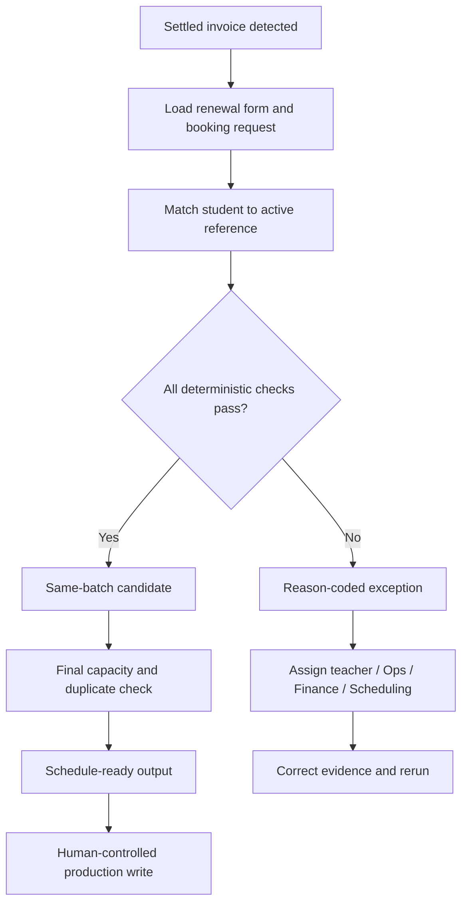

# Workflow and operating logic

## Guardrails
1. Payment status is checked from the authoritative source.
2. A student match must be unique.
3. Same-batch continuation is the only proposed automatic path in this prototype.
4. Batch changes and ambiguous data are held.
5. Existing schedule records are reviewed to avoid duplicates.
6. No live schedule writes are performed by this repository.
